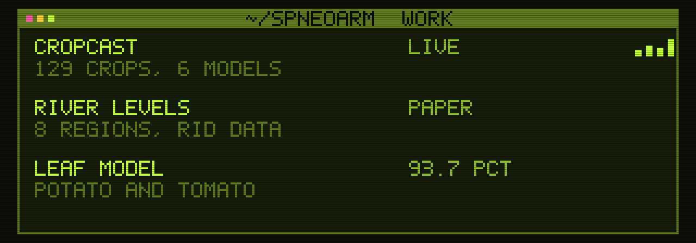

**Supanut Eiamoon**, Thailand.

I build software with AI agents. They write the code. I set the goal, read every diff, and decide what ships.

## Selected work

- **[CropCast](https://cropcast.space)** — live prices and a forecast for 129 Thai crops. Six models run. The one that wins the backtest is the one shown. A forecast is an estimate, not a promise.  
  `typescript` `python` `fastapi` `supabase`
- **River levels** — water level and flood risk across eight regions of Thailand, from official RID data. The paper is written in R.  
  `r` `time series`
- **[Smart Leaf AI](https://github.com/spneoarm/smart-leaf-ai)** — a photo of a potato or tomato leaf comes back with a disease. 93.7% on the test set. [Try it](https://smart-leaf-ai-j3iislqqio8qgaoft7adbk.streamlit.app/)  
  `pytorch` `resnet18` `streamlit`
- **Two Mac apps** — session status on the menu bar and the Touch Bar. Personal tools.  
  `swift` `macos`

## Four agents

Each agent has one job. None of them can merge. That step is mine.

## How a change ships

1. **Plan** — I write the goal and the steps before any code.
2. **Build** — An agent makes one small change, on its own branch.
3. **Check** — Tests, typecheck, and lint run. CI runs the heavy tests.
4. **Review** — I read the diff. A second agent reviews it too.
5. **Ship** — The change goes up as a draft pull request. It merges only when I say so.

## Workshop

`MCP servers` connect the agents to real tools: **Supabase**, **Playwright**, **a browser**, **Sentry**, **Context7**.  
`Skills` give them a method: **Superpowers**, for planning, test-first work, and code review.

## Stack

The agents write the diff. I own the result.
