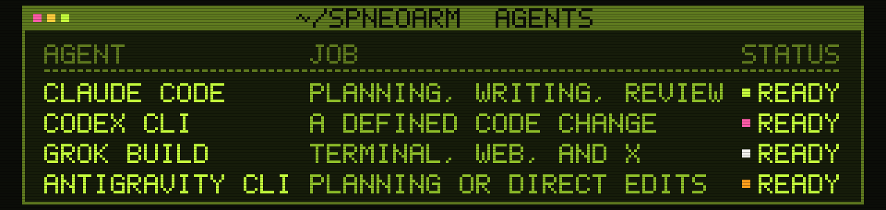

I am **Supanut Eiamoon**, a vibe coder in Thailand.

I build software with AI coding agents. I set the goal and the plan. The agents write the code. I check every change before it ships.

## My AI team

Each agent has one clear job, so the work does not overlap.

## How I ship

1. **Plan** — I write the goal and the steps before any code.
2. **Build** — An agent makes one small change at a time, on its own branch.
3. **Check** — Tests, typecheck and lint run. CI runs the heavy tests.
4. **Review** — I read the diff, and a second agent reviews it.
5. **Ship** — The change goes up as a draft pull request. It merges only when I say so.

## Around the agents

`MCP servers` give the agents real tools: **Supabase**, **Playwright**, **Claude in Chrome**, **Sentry**, **Context7**.  
`Skills` give them a method: **Superpowers** for planning, test-first work, and code review.

## Stack my agents build in

AI writes the code. I own the result.
