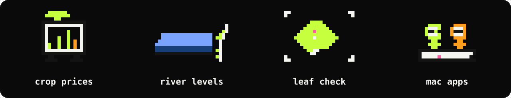

### hi, i'm supanut

i turn public data from thailand into a forecast, then into an app.
mostly crop prices and river levels.
a forecast here is an estimate. it is not a promise.

### work you can open

- **[CropCast](https://cropcast.space)** · live daily prices and a forecast for 129 thai crops. six models run. the one that wins the backtest is the one shown  
  `typescript` `python` `fastapi` `supabase`
- **river levels** · water level and flood risk across eight regions, from official RID data. the paper is in R  
  `r` `time series`
- **[Smart Leaf AI](https://github.com/spneoarm/smart-leaf-ai)** · a photo of a potato or tomato leaf comes back with a disease. 93.7% on the test set · [try it](https://smart-leaf-ai-j3iislqqio8qgaoft7adbk.streamlit.app/)  
  `pytorch` `resnet18` `streamlit`
- **Claude Critter** and **Codex Critter** · session status for Claude Code and Codex CLI, on the menu bar and the touch bar. personal mac apps  
  `swift` `macos`
- **scalp tracker** · a phone app that records scalp health over time  
  `react native` `expo`

### how i use AI

i use four tools. each one has a defined role.

| tool | role |
| --- | --- |
| **Claude Code** | planning, careful writing, and review |
| **Codex CLI** | a defined task, delivered as a code change |
| **Grok Build** | terminal work, current web pages, and posts on X |
| **Antigravity CLI** | planning, or a direct edit in the terminal |

### tools i reach for

bio says vibe-coder pro max. the commit history agrees.
