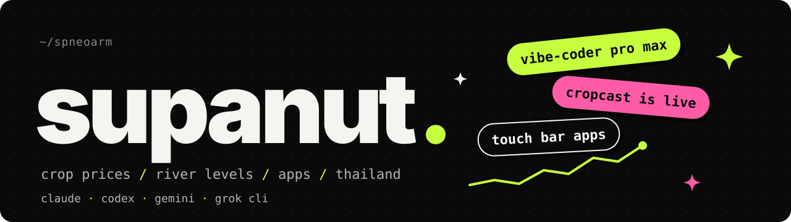
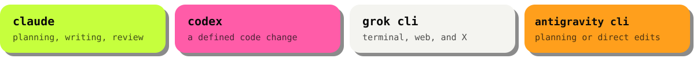

### hi, i'm supanut

i take messy public data, forecast it, and ship it as an app people actually use.
mostly crop prices and river water in thailand.

i use four AI tools. each one has a defined role.

| tool | role |
| --- | --- |
| **claude** | planning, careful writing, and review |
| **codex** | a defined task, delivered as a code change |
| **grok cli** | terminal work, current web pages, and posts on X |
| **antigravity cli** | planning, or a direct edit in the terminal |

**claude critter** and **codex critter** show those sessions on the macbook menu bar and touch bar.

### rn

- **[cropcast](https://cropcast.space)** is live. thai farmers can check the price, and a forecast, before they sell
- writing a paper on river levels across eight regions of thailand, from official RID data. yes, in R
- two small mac apps sit on the touch bar: one for claude, one for codex

### stuff i made

- **[smart leaf ai](https://github.com/spneoarm/smart-leaf-ai)** · snap a potato or tomato leaf, get the disease. 93.7% test accuracy · [try it](https://smart-leaf-ai-j3iislqqio8qgaoft7adbk.streamlit.app/)  
  `pytorch` `resnet18` `streamlit`
- **[cropcast](https://cropcast.space)** · daily prices and forecasts for 129 thai crops. six models, and the best one per crop wins the backtest  
  `typescript` `python` `fastapi` `supabase`
- **river level forecasting** · water levels and flood risk across eight regions of thailand, from official RID data  
  `r` `time series`
- **scalp tracker** · a phone app to track scalp health over time  
  `react native` `expo`
- **claude critter** · claude code sessions, live on the menu bar and the touch bar  
  `swift` `macos`
- **codex critter** · a mint robot for codex sessions, on the menu bar and the touch bar  
  `swift` `macos`

### tools i reach for

bio says vibe-coder pro max. the commit history agrees.
